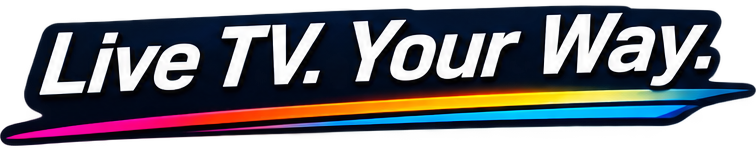
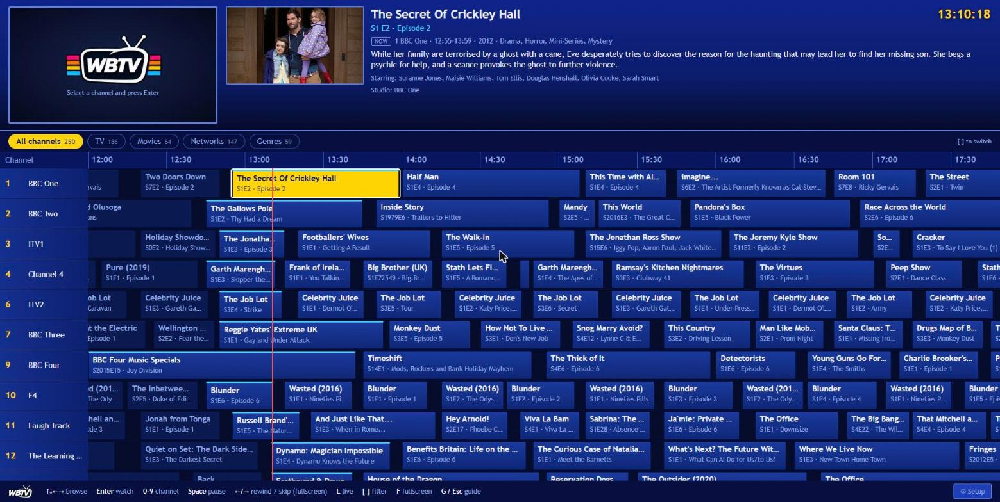
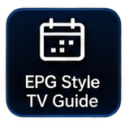
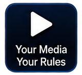
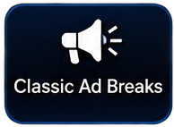
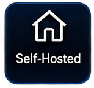
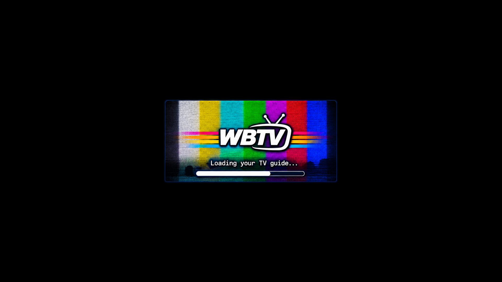
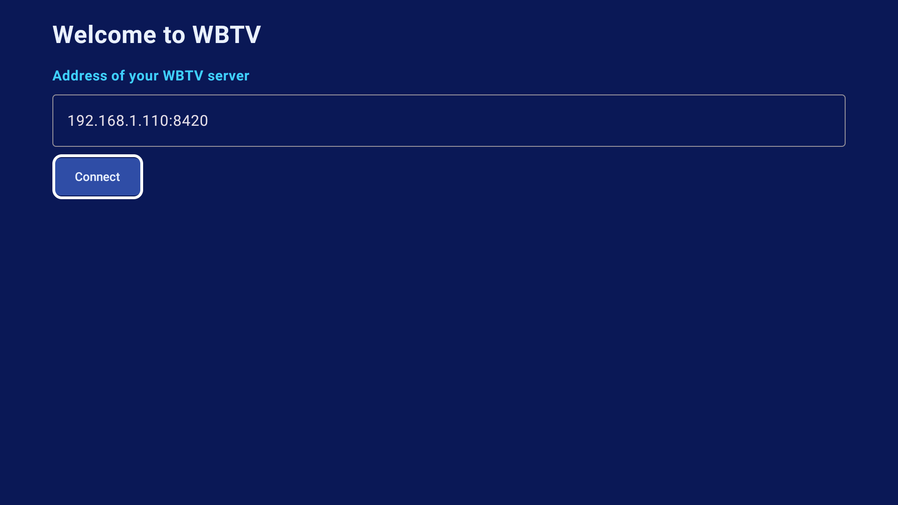

<p align="center">
  
</p>

<p align="center">
  
</p>

<p align="center">
  <a href="https://buymeacoffee.com/succinctrecords"></a>
</p>

<p align="center"><b>WBTV is free and always will be. If it brings you joy, a coffee keeps the updates coming. ☕</b></p>

**WBTV turns your own media library into a live TV service.** Point it at your movies and shows, and it builds
channels from your `.nfo` tags, then "broadcasts" them on a persistent schedule. Open a channel and you join
whatever is on *right now*, mid-programme, exactly like real television, complete with an old-school EPG guide
and (if you like) nostalgic ad breaks.

<p align="center">
  
</p>

<p align="center">
  
</p>

## Features

| | |
|---|---|
| <br>**EPG-style guide** | A Freeview-era grid: what's on now, what was on, what's next. Poster, plot, cast and studio for every programme. |
| <br>**Your media, your rules** | Add folders like in Jellyfin and say what they contain (TV, Movies, Ads). Channels are built automatically from your NFO tags. |
| <br>**Classic ad breaks** | Optional mid-programme breaks and programmes that start on the dot, using old adverts you supply (links or local folders). |
| <br>**Self-hosted** | One Docker container. Your files stay read-only on your disk. Web UI plus a native Android TV app. |

- **Channels are inferred from your tags.**
  - TV shows go on a channel named after their `<studio>` tag (BBC One, ITV1, Channel 4...). A show can be on several studio channels.
  - Shows with no (big enough) studio land on themed genre channels, e.g. *The Spooky Channel* for Horror.
  - Movie libraries only feed movie channels: genre channels (*Fright Night Cinema*), studio channels and decade channels (*1990s Cinema*).
  - Rename, renumber or disable any channel in Setup. Your edits survive rescans.
- **Music channels.** Point WBTV at a folder of music videos and it builds Sky-style music channels by genre and decade (*Pop Videos*, *Rock Box*, *1990s Music TV*...), playing back to back with an "Artist – Title" lower-third on every track. Uses `<musicvideo>` NFOs, or just name files `Artist - Title.mp4`.
- **Radio channels.** Point it at your audio files (mp3, flac, m4a, ogg...) and it builds radio stations by genre and decade (*Rock FM*, *Jazz FM*, *1990s Radio*...). The stream shows cover art, now-playing text and a live waveform. Tags are read from the files.
- **Live TV, IPTV and news.** Add an M3U/M3U8 playlist (URL or file), a single HLS stream or a YouTube live link and each stream becomes a channel. Streams are health-checked so dead ones are hidden, and one-click suggestions (e.g. the public iptv-org news list) are built in. Live channels sit in the same guide, with pause/rewind and the same themes.
- **Smart scheduling.** WBTV leans towards what suits the time of day using your own genres and age ratings (cartoons on Saturday morning, mature and horror late), and prefers adverts from the same era as the programme (year read from the ad's title or folder name).
- **Authentic presentation.** Optional channel logos or name bug, generated station idents, and an overnight closedown test card, all switchable in Settings.
- **Works with your other apps.** M3U playlist, XMLTV guide and HDHomeRun emulation for Plex, Jellyfin, TiviMate and more. Optional password.
- **Fast, incremental scans** that lean on NFO data (including `durationinseconds`, so ffprobe is rarely needed). Rescans run automatically on a timer.
- **A real schedule.** Planned ahead and persisted, so the guide and the stream always agree, with history you can scroll back to. Every viewer of a channel shares one live stream.
- **Ad breaks (optional).** Add YouTube / archive.org / direct links (downloaded once with yt-dlp) or point at local folders tagged *TV* or *Movies* (so trailers only play on movie channels). Long ad-break compilations are supported: each break plays a random chunk, like joining a recorded break in progress.
- **"Coming up next" announcements.** After each programme a continuity slot plays: a clip from inside the next programme with a voice reading out what's on next and after that, using each programme's description (with sensible fallbacks), plus UP NEXT / AFTER THAT / LATER captions. The voice is generated locally with [Piper](https://github.com/rhasspy/piper): offline, free, no AI service. Two British voices (Alan and Jenny) come built in, and more natural-sounding ones (including high-quality British and American voices) can be installed with one click from Setup > Announcements. Numbers, years, episode codes ("S04E10"), abbreviations and punctuation are turned into speech the way a person would say them ("nineteen eighty-nine", "season four, episode ten").
- **Filter chips** above the guide: All channels, TV, Movies, Music, Radio, Live, Networks (studio channels) and Genres (chips with nothing in them are hidden).
- **Pause and rewind live TV.** A rolling buffer on the server (10 minutes by default) lets you pause, skip back and return to live, on the web and on Android TV.
- **Know how long is left.** The info banner shows a progress bar and "N min left" for the current programme, what's next, and how far behind live you are if you've paused.
- **Always tunable.** Between programmes (ad breaks and announcements) a channel is still on air and you can still tune to it.
- **Nine themes**: Classic, Vintage, 90s, Modern, Aero, Teletext, Synthwave and two **Satellite** looks (classic and HD) inspired by the early-2000s UK satellite guide, with the live preview kept. On the web and on Android TV.
- **Android TV app** with a proper remote-control experience, a full settings screen, and server controls (ads, announcements, rescans) right from the sofa (see below).

## Quick start

```yaml
# docker-compose.yml
services:
  wbtv:
    image: wb20244/wbtv:latest
    container_name: wbtv
    restart: unless-stopped
    ports:
      - 8420:8080
    environment:
      - TZ=Europe/London
    volumes:
      - /opt/wbtv:/config                  # database + downloaded ads
      - /mnt/Main20TB:/mnt/Main20TB:ro     # your media, read-only
    tmpfs:
      - /tmp/wbtv:size=2g                  # live stream segments (incl. the pause/rewind buffer)
```

```bash
docker compose up -d
```

Then open `http://<host>:8420`, click **Setup**, and add your first library folder.

| Environment variable | Default | |
|---|---|---|
| `WBTV_WIDTH` / `WBTV_HEIGHT` | `1280` / `720` | Stream resolution |
| `WBTV_CRF` | `23` | x264 quality (lower = better and bigger) |
| `WBTV_PRESET` | `veryfast` | x264 speed preset |
| `WBTV_BROWSE_ROOTS` | `/mnt,/media,/data` | Folders the in-app folder browser may show |
| `PIPER_BIN` / `PIPER_VOICES` | `/opt/piper/piper` / `/opt/piper/voices` | Speech engine and voice folder (already in the image) |

> **No authentication.** WBTV is designed for your home network. Don't expose it to the internet.

## Setup

<p align="center">
  
  
</p>
<p align="center">
  
  
</p>
<p align="center">
  
</p>

1. **Libraries**: add a folder and say what's in it: *TV Shows*, *Movies*, *Music videos* or *Radio* feed channels; *Ads* folders feed ad breaks.
2. **Live TV**: add an IPTV playlist, a stream or a YouTube live link (see below).
3. **Channels**: check what was built (there is a search box), rename or renumber things, switch channels on and off.
4. **Ads** (optional): turn on ad breaks, set how long and how often, add ad folders or links.
5. **Announcements**: switch the "coming up next" voice-overs on or off, pick the voice (with a sample button) or install more voices (the high-quality ones sound best but need roughly three times the CPU to generate), and choose how many programmes to mention and how long it may run.
6. **Settings**: automatic rescans, the pause/rewind buffer, and how many channels get created (minimum channel size, genre channels for every show, movie studio and decade channels).
7. **Appearance**: pick a theme, and choose whether selecting a programme jumps straight to fullscreen.

### Music, radio and live channels

| Add this | Library type | What you get |
|---|---|---|
| Music video folder | **Music videos** | Channels by genre/decade, numbered from 400, lower-third per track |
| Audio folder (mp3/flac/m4a...) | **Radio** | Radio stations by genre/decade, numbered from 800, cover art + waveform |
| Interview recordings | **Radio: interviews** | One station named after the library, shuffled |
| Podcast folders (one folder per show) | **Radio: podcasts** | One station that rotates between shows; each show's episodes play oldest first |
| Audiobooks (`.m4b`, or a folder of chapter files per book) | **Radio: audiobooks** | One station: one book at a time, chapters in order, then the next book |

Spoken-word stations read the tags in your files (title, show or book, author, date, track number, description) and fall back to folder names. Embedded cover art (the usual place for `.m4b` covers) is picked up automatically. Like a real broadcast, you join mid-episode.
| `.m3u` / `.m3u8` playlist, single stream, or YouTube live URL | **Live TV** tab | One channel per stream, numbered from 600; dead streams hidden |

Big playlists (more than 80 streams) start with the first 80 *working* channels switched on; use the **Channels** tab search box and *Enable shown* to switch on more, or *Enable all working* on the Live TV tab. The built-in suggestions point at public community lists of free streams (not run by WBTV), so availability changes and some are region-locked. YouTube live links are resolved with yt-dlp each time you tune in.

Use the **filter chips** above the guide (or `[` and `]`) to show only TV channels, movie channels, networks or genres:

<p align="center">
  
</p>

**Web keys:** arrows to browse, Enter to watch, 0-9 for a channel number, Space to pause, Left/Right to rewind or skip in fullscreen, L to go back to live, F for fullscreen, G or Esc for the guide.

## Use WBTV in Plex, Jellyfin, TiviMate and other players

WBTV can act as a TV tuner, so every channel (with its ads and announcements) shows up in the apps you already use.

| You want to use | Add this |
|---|---|
| **Plex / Jellyfin / Emby Live TV** | Add an *HDHomeRun* tuner at `http://<server>:8420`, then use the XMLTV guide below |
| **TiviMate, VLC, Kodi, Channels, any IPTV app** | Playlist: `http://<server>:8420/iptv/playlist.m3u` |
| **Guide data (XMLTV)** | `http://<server>:8420/iptv/epg.xml` (36 hours ahead) |

The HDHomeRun emulation serves a normal MPEG-TS stream without re-encoding, so it costs almost no extra CPU on top of the shared channel stream.

## Password (optional)

WBTV is built for a home network and has no login by default. If you open it to the internet (or just want a lock on it), turn on a password in **Setup > Settings > Security**. Browsers log in once; the Android TV app, IPTV players and Plex/Jellyfin use an **access key** shown on the same page (the Android app has a field for it). Don't expose any self-hosted app to the internet over plain http; put it behind HTTPS (a reverse proxy such as Caddy or Nginx Proxy Manager). The full API is documented in [docs/API.md](docs/API.md).

## If channels are slow to start

Every channel you watch is encoded live, so start-up time depends on how busy the server's CPU is. If the machine also runs other apps, try these in **Setup > Settings > Video encoding**:

- **Stream size:** 576p uses roughly 30% less CPU per channel than 720p (measured on a 1080p source); 480p is the lightest.
- **Hardware encoding:** see below, if the server has a GPU.
- Fewer simultaneous viewers: each channel being watched is its own encoder, and a channel stops about 25 seconds after its last viewer leaves.

WBTV logs a line such as `tune-in 7.4s (slow): ... ` whenever a channel takes more than 6 seconds to start, with a breakdown of where the time went (`docker logs wbtv`). Set `WBTV_DEBUG=1` to log every start.

## Hardware encoding (optional)

By default WBTV encodes on the CPU (x264). If the server has a GPU you can hand the encode to it, which frees the CPU for more channels at once. Settings > Video encoding is **Automatic** by default: WBTV runs a real test encode and silently falls back to the CPU if the GPU is not usable, and the Settings page tells you which one is in use.

- **Intel / AMD (VAAPI):** pass the GPU in: add `devices: ["/dev/dri:/dev/dri"]` to the compose service (on Proxmox LXC, pass the `/dev/dri/renderD128` device through to the container first).
- **NVIDIA (NVENC):** install the NVIDIA container toolkit and add `runtime: nvidia` with `NVIDIA_VISIBLE_DEVICES=all` and `NVIDIA_DRIVER_CAPABILITIES=video,compute,utility`.

Scaling and on-screen captions still run on the CPU; only the H.264 encode moves.

## Themes

<p align="center">
  
  
</p>
<p align="center">
  
  
</p>
<p align="center">
  
  
</p>
<p align="center">
  
  
</p>

## Android TV app

<p align="center">
  
</p>

`android/` contains a native Kotlin / Jetpack Compose / Media3 app. It opens on your last channel, like switching a
TV on, and is built for the remote.

<p align="center">
  
  
</p>
<p align="center">
  
  
</p>
<p align="center">
  
  
</p>

| Key | Watching | In the guide |
|---|---|---|
| Up / Down, CH+ / CH- | next / previous channel | move between channels; Up from the top row goes to the filter chips and **Settings** |
| Left | last channel | previous programme |
| Right | info banner (progress, minutes left) | next programme |
| OK / Guide | open guide | tune it (a live programme, or any programme if the channel is between programmes); fullscreen if the setting is on |
| Play / Pause | pause or resume live TV | same |
| Rewind / Fast-forward | back 30 s / forward 30 s (past the live edge = back to live) | |
| 0-9 | jump to channel number | same |
| Menu | settings | settings |
| Back | press twice to exit | close the guide |

**Settings** (Menu, or Up from the top row of the guide then the Settings button): theme, fullscreen behaviour, and the server's own switches (ad breaks, "coming up next" announcements, automatic rescans, pause/rewind buffer, scan now), so you can change them without a laptop.

**Build** (needs JDK 17+ and the Android SDK, e.g. from Android Studio):

```bash
cd android
./gradlew assembleDebug        # -> app/build/outputs/apk/debug/app-debug.apk
adb connect <tv-ip>:5555
adb install -r app/build/outputs/apk/debug/app-debug.apk
```

On first launch the app asks for your server address, e.g. `192.168.1.110:8420`. Tested on a Fire TV (Android 9);
it needs Android 8 or newer.

## Project layout

```
src/         Node.js server: scanner, channel inference, scheduler, live HLS broadcaster, API
public/      Web UI (vanilla JS)
android/     Android TV app (Kotlin, Compose, Media3); unit tests: ./gradlew testDebugUnitTest
Images/      Artwork (Assets) and screenshots (Screenshots)
test/        Unit tests (npm test)
Dockerfile   Node 24 + ffmpeg + yt-dlp + Piper (speech)
```

## ☕ Support WBTV

WBTV is **free, open source and will stay that way**. It is built and tested in spare time on real hardware (a Proxmox box and a Fire TV). If you enjoy it, please consider supporting development. Every coffee goes straight into new features and keeping things working.

<p align="center">
  <a href="https://buymeacoffee.com/succinctrecords"></a>
</p>

Not able to donate? A star on the repo and telling a friend helps just as much. ⭐

<p align="center">
  
</p>
