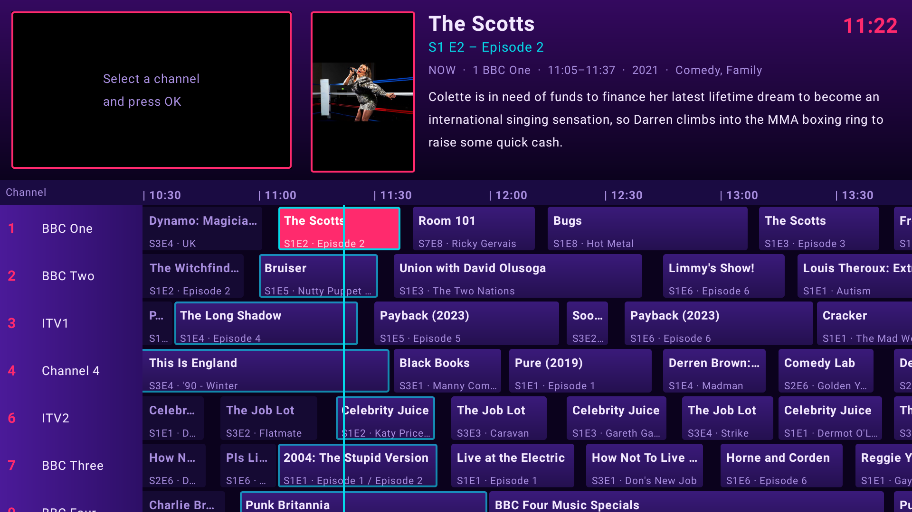

<p align="center">
  
</p>

<p align="center">
  
</p>

**WBTV turns your own media library into a live TV service.** Point it at your movies and shows, and it builds
channels from your `.nfo` tags, then "broadcasts" them on a persistent schedule. Open a channel and you join
whatever is on *right now*, mid-programme, exactly like real television, complete with an old-school EPG guide
and (if you like) nostalgic ad breaks.

<p align="center">
  
</p>

<p align="center">
  
</p>

## Features

| | |
|---|---|
| <br>**EPG-style guide** | A Freeview-era grid: what's on now, what was on, what's next. Poster, plot, cast and studio for every programme. |
| <br>**Your media, your rules** | Add folders like in Jellyfin and say what they contain (TV, Movies, Ads). Channels are built automatically from your NFO tags. |
| <br>**Classic ad breaks** | Optional mid-programme breaks and programmes that start on the dot, using old adverts you supply (links or local folders). |
| <br>**Self-hosted** | One Docker container. Your files stay read-only on your disk. Web UI plus a native Android TV app. |

- **Channels are inferred from your tags.**
  - TV shows go on a channel named after their `<studio>` tag (BBC One, ITV1, Channel 4...). A show can be on several studio channels.
  - Shows with no (big enough) studio land on themed genre channels, e.g. *The Spooky Channel* for Horror.
  - Movie libraries only feed movie channels: genre channels (*Fright Night Cinema*), studio channels and decade channels (*1990s Cinema*).
  - Rename, renumber or disable any channel in Setup. Your edits survive rescans.
- **Fast, incremental scans** that lean on NFO data (including `durationinseconds`, so ffprobe is rarely needed). Rescans run automatically on a timer.
- **A real schedule.** Planned ahead and persisted, so the guide and the stream always agree, with history you can scroll back to. Every viewer of a channel shares one live stream.
- **Ad breaks (optional).** Add YouTube / archive.org / direct links (downloaded once with yt-dlp) or point at local folders tagged *TV* or *Movies* (so trailers only play on movie channels). Long ad-break compilations are supported: each break plays a random chunk, like joining a recorded break in progress.
- **Seven themes**: Classic, Vintage, 90s, Modern, Aero, Teletext and Synthwave, on the web and on Android TV.
- **Android TV app** with a proper remote-control experience (see below).

## Quick start

```yaml
# docker-compose.yml
services:
  wbtv:
    image: wb20244/wbtv:latest
    container_name: wbtv
    restart: unless-stopped
    ports:
      - 8420:8080
    environment:
      - TZ=Europe/London
    volumes:
      - /opt/wbtv:/config                  # database + downloaded ads
      - /mnt/Main20TB:/mnt/Main20TB:ro     # your media, read-only
    tmpfs:
      - /tmp/wbtv:size=1g                  # live stream segments
```

```bash
docker compose up -d
```

Then open `http://<host>:8420`, click **Setup**, and add your first library folder.

| Environment variable | Default | |
|---|---|---|
| `WBTV_WIDTH` / `WBTV_HEIGHT` | `1280` / `720` | Stream resolution |
| `WBTV_CRF` | `23` | x264 quality (lower = better and bigger) |
| `WBTV_PRESET` | `veryfast` | x264 speed preset |
| `WBTV_BROWSE_ROOTS` | `/mnt,/media,/data` | Folders the in-app folder browser may show |

> **No authentication.** WBTV is designed for your home network. Don't expose it to the internet.

## Setup

<p align="center">
  
  
</p>
<p align="center">
  
  
</p>

1. **Libraries**: add a folder and say what's in it. *TV Shows* and *Movies* feed channels; *Ads* folders feed ad breaks.
2. **Channels**: check what was built, rename or renumber things, switch channels off.
3. **Ads** (optional): turn on ad breaks, set how long and how often, add ad folders or links.
4. **Settings**: automatic rescans, and how many channels get created (minimum channel size, genre channels for every show, movie studio and decade channels).
5. **Appearance**: pick a theme, and choose whether selecting a programme jumps straight to fullscreen.

## Themes

<p align="center">
  
  
</p>
<p align="center">
  
  
</p>
<p align="center">
  
  
</p>

## Android TV app

<p align="center">
  
</p>

`android/` contains a native Kotlin / Jetpack Compose / Media3 app. It opens on your last channel, like switching a
TV on, and is built for the remote.

<p align="center">
  
  
</p>
<p align="center">
  
  
</p>

| Key | Watching | In the guide |
|---|---|---|
| Up / Down, CH+ / CH- | next / previous channel | move between channels |
| Left | last channel | previous programme |
| Right | open guide | next programme |
| OK / Guide | open guide | tune a live programme (fullscreen if the setting is on) |
| 0-9 | jump to channel number | same |
| Menu | server, theme and behaviour settings | same |
| Back | press twice to exit | close guide |

**Build** (needs JDK 17+ and the Android SDK, e.g. from Android Studio):

```bash
cd android
./gradlew assembleDebug        # -> app/build/outputs/apk/debug/app-debug.apk
adb connect <tv-ip>:5555
adb install -r app/build/outputs/apk/debug/app-debug.apk
```

On first launch the app asks for your server address, e.g. `192.168.1.110:8420`. Tested on a Fire TV (Android 9);
it needs Android 8 or newer.

## Project layout

```
src/         Node.js server: scanner, channel inference, scheduler, live HLS broadcaster, API
public/      Web UI (vanilla JS)
android/     Android TV app (Kotlin, Compose, Media3)
Images/      Artwork (Assets) and screenshots (Screenshots)
Dockerfile   Node 24 + ffmpeg + yt-dlp
```

<p align="center">
  
</p>
