<p align="center">
  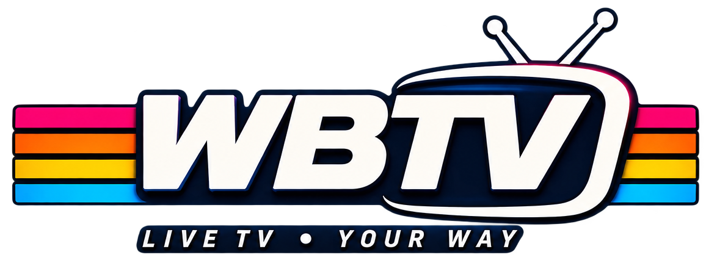
</p>

<h3 align="center">Your own media, broadcast as real live TV.<br>No setup, no schedules to build. Point it at your library and press play.</h3>

<p align="center">
  <a href="https://github.com/WB2024/WBTV/releases/latest"></a>
  <a href="https://hub.docker.com/r/wb20244/wbtv"></a>
  <a href="https://github.com/WB2024/WBTV/actions/workflows/docker.yml"></a>
  <a href="LICENSE"></a>
  <a href="https://github.com/WB2024/WBTV/stargazers"></a>
</p>

<p align="center">
  <a href="https://buymeacoffee.com/succinctrecords"></a>
</p>

<p align="center">
  <a href="https://launchorbit.co" target="_blank" rel="noopener noreferrer"></a>
</p>

<p align="center"><b>WBTV is free, open source and always will be. If it brings you joy, a coffee keeps the updates coming. ☕</b></p>

<p align="center">
  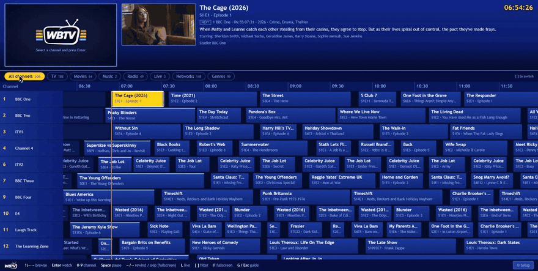<br>
  <sub>The guide, browsing and filtering a real library: TV, Movies, Music, Radio, Live and Networks.</sub>
</p>

## Quick start: one container, one volume

```bash
docker run -d --name wbtv --restart unless-stopped -p 8420:8080 -e TZ=Europe/London \
  -v "$PWD/config:/config" -v /path/to/your/media:/media:ro --tmpfs /tmp/wbtv:size=2g \
  wb20244/wbtv:latest
```

Change `/path/to/your/media` to your media folder (it is mounted **read-only**, WBTV never changes your files) and your timezone. That's the whole install.

<details>
<summary>Prefer Docker Compose?</summary>

```yaml
services:
  wbtv:
    image: wb20244/wbtv:latest
    container_name: wbtv
    restart: unless-stopped
    ports:
      - 8420:8080
    environment:
      - TZ=Europe/London              # your timezone, so the guide matches your clock
    volumes:
      - ./config:/config              # database, covers, voices, downloaded ads
      - /path/to/your/media:/media:ro # your media, read-only
    tmpfs:
      - /tmp/wbtv:size=2g             # live stream segments + the pause/rewind buffer (RAM)
```

```bash
docker compose up -d
```
</details>

Then:

1. Open **`http://<your-server>:8420`** and click **Setup**.
2. **Libraries > Add**: browse to your TV, movie, music, or audiobook folders and say what each one contains.
3. Wait a minute for the first scan. Channels and the guide appear. Pick one and press **Enter**.

That's it. Everything else (ad breaks, voice-overs, themes, idents, the Android TV app) is optional and one click away.

**Good to know**
- Mount your media at `/media` (or `/mnt`, `/data`) so the folder browser can see it. Other places: set `WBTV_BROWSE_ROOTS`.
- You need roughly **one CPU core per channel being watched** (every watched channel is encoded live, and all viewers of a channel share one encode). Details in [performance](#performance).
- Works on Unraid, Synology/QNAP (Container Manager), TrueNAS, Proxmox LXC and plain Linux. Images are published for **amd64**; an **arm64** build (Raspberry Pi 4/5, Apple silicon) is produced by CI, see [Status](#status).
- Media can be anywhere Docker can read, including network shares. Rescans are incremental and quick.

---

## What is it?

Remember flicking through the channels, landing on something halfway through, and just *watching it*? WBTV brings that back using the
library you already own.

It scans your folders, reads your `.nfo` tags, and **builds the channels itself**: every studio becomes a channel (*BBC One*, *Channel 4*...),
every genre a themed one (*The Spooky Channel*, *1990s Cinema*, *Jazz FM*). Then it "broadcasts" them on a real, persistent schedule with
a proper TV guide, ad breaks, a voice telling you what's on next, and a native Android TV app. Switch on, tune in, and you join whatever is
on *right now*. The same way you did in 1998.

<table>
<tr>
<td width="33%" valign="top"><b>🧙 Zero setup</b><br>Add a folder. Channels, numbers, names and a 14-hour guide appear on their own. No schedule editor to learn.</td>
<td width="33%" valign="top"><b>📺 Feels like TV</b><br>A guide grid, channel surfing, programmes that start on the dot, ad breaks, idents, a closedown test card and a voice saying "coming up next".</td>
<td width="33%" valign="top"><b>📱 Built for the sofa</b><br>A native Android TV / Fire TV app made for the remote, plus the web UI, plus Plex, Jellyfin, Emby and TiviMate through its tuner output.</td>
</tr>
</table>

## Why people switch to WBTV

If you have tried ErsatzTV, Tunarr, FieldStation42 or similar, you know the drill: build every channel by hand, craft every schedule, then wire it up
to something else to watch it. WBTV does it the other way round.

| | **WBTV** | Typical "fake TV" tools |
|---|---|---|
| Channels | **Built automatically** from your studio and genre tags | You create each one |
| First run | Add a folder, watch TV | Channels, schedules, sources, players to configure |
| Watching | Own **web UI + native Android TV / Fire TV app**, or any IPTV/Plex/Jellyfin app | Needs a separate player or Plex/Jellyfin |
| "Coming up next" voice-overs | ✅ local neural voices, one-click installs | ❌ |
| Time-of-day scheduling | ✅ cartoons after school, horror late, from *your* metadata | Hand-built |
| Adverts | ✅ YouTube / archive.org / local, **matched to the programme's era** | ❌ or basic |
| Music videos, radio, **audiobooks, podcasts, interviews**, live IPTV and YouTube live | ✅ all in the same guide | Partial |
| Lyrics and cover art on radio | ✅ time-synced `.lrc` | ❌ |
| Looks | ✅ 9 themes, incl. Freeview and early-2000s satellite guides | Plain |
| Cost | **Free, MIT licensed** | Mostly free |

> Want the full, fair comparison, including where ErsatzTV, Tunarr and FieldStation42 are ahead? See **[docs/COMPARISON.md](docs/COMPARISON.md)**.

## How channels are built

You don't make channels. WBTV works them out from the tags you already have:

| Your library | What WBTV creates |
|---|---|
| TV shows tagged `<studio>BBC One</studio>` | A **BBC One** channel (a show can sit on several studio channels) |
| Shows with no big studio | Themed genre channels, e.g. **The Spooky Channel** for Horror |
| Movies | **Fright Night Cinema** (genre), **Warner Bros.** (studio), **1990s Cinema** (decade) |
| Music videos | **Pop Videos**, **Rock Box**, **1990s Music TV**, with an Artist - Title lower-third |
| Audio files | **Jazz FM**, **Rock FM**, **1990s Radio**, with cover art, lyrics and a live waveform |
| Interviews, podcasts, audiobooks (`.m4b` too) | A spoken-word station for each: podcasts rotate between shows, audiobooks play chapter by chapter |
| IPTV playlists, HLS links, YouTube live | One channel per stream; dead ones are hidden automatically |

Rename, renumber or switch off anything in **Setup**. Your edits survive rescans.

## Highlights

**The TV experience**
- 📺 **EPG guide grid** with posters, plots, cast and studio, filter chips (TV, Movies, Music, Radio, Live, Networks, Genres) and 9 themes
- ⏯️ **Pause, rewind and skip live TV**, with a "N min left" progress banner and a one-key jump back to live
- 🕰️ **A real schedule**: planned ahead, saved, and always matching what's on screen. Scroll back through history
- 📡 **Always tunable**: even between programmes, a channel is still on air

**Authentic presentation**
- 🗣️ **"Coming up next" announcements**: a clip from the next programme with a voice reading what's on next and after that, generated **locally and offline** (Piper), with natural pronunciation of years, episode codes and abbreviations. More voices install in one click
- 📼 **Classic ad breaks** from YouTube, archive.org, direct links or local folders, **matched to each programme's era**, with separate pools for TV and movie channels
- 🌙 **Station idents (generated, or your own clips), channel logos and an overnight closedown test card**
- 💬 **Audio language and subtitles**: the track in your language is used, and subtitles are burned in when a file has no audio in it (anime, foreign films), including forced subtitles for foreign dialogue
- 🧠 **Smart dayparting** from your genres and age ratings: cartoons on Saturday morning, mature and horror late

**Music and radio**
- 🎵 **Music-video channels** with lower-thirds, **radio stations** with cover art and a live waveform
- 🎤 **Lyrics**: drop a `.lrc` next to a track (or keep lyrics in the tags) and they play, time-synced, under the cover art
- 🎙️ **Spoken-word stations**: interviews, podcasts and **audiobooks (`.m4b` with chapters and embedded covers)**

**Works with everything**
- 🔌 **Tuner output**: HDHomeRun emulation, an **M3U playlist** and **XMLTV guide** for Plex, Jellyfin, Emby, TiviMate, VLC, Kodi and more
- 🗄️ **Jellyfin, Emby and Navidrome as a source**: connect with an API key (or a Navidrome login) and WBTV builds channels from those libraries too. Folders still work and you can mix both: [which is better for you?](#folders-or-a-media-server)
- 🌐 **Live TV**: add any M3U/M3U8 playlist, HLS stream, or YouTube live link
- 📱 **Native Android TV / Fire TV app** (Kotlin, Compose, Media3) with a full on-TV settings screen, and a **[Samsung (Tizen) TV app](#samsung-tv-app)**
- 🔒 **Optional password and access key**, and a documented [HTTP API](docs/API.md)
- ⚡ **Hardware encoding** (Intel/AMD VAAPI, NVIDIA NVENC) with an automatic self-test and CPU fallback

> The complete list of everything WBTV does is in **[docs/FEATURES.md](docs/FEATURES.md)**.

<p align="center">
  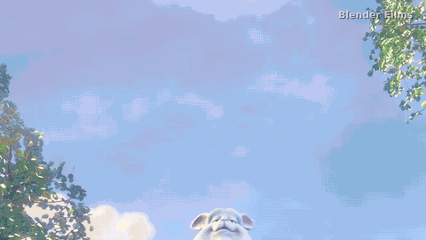<br>
  <sub>A programme with its channel bug, then the <b>"coming up next"</b> slot: a clip from the next programme under an UP NEXT caption, with a voice reading out what's on (generated locally, offline). The demo uses clips from the CC-licensed film <i>Big Buck Bunny</i> (&copy; Blender Foundation).</sub>
</p>

<table align="center">
<tr>
<td align="center">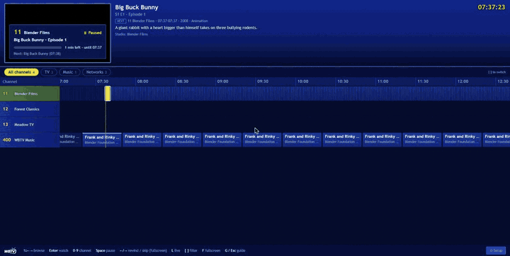<br><sub><b>Pause and rewind live TV</b>, with a banner showing what's on, what's next and how far behind live you are</sub></td>
<td align="center"><br><sub><b>Music-video channels</b> with an Artist - Title lower-third on every track</sub></td>
</tr>
</table>

<table align="center">
<tr>
<td align="center"><br><sub><b>Station idents</b>, generated for every channel</sub></td>
<td align="center">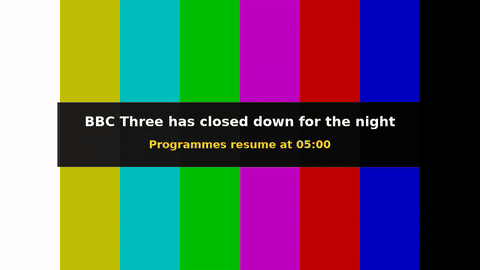<br><sub><b>Closedown</b> test card, overnight</sub></td>
</tr>
</table>

<p align="center">
  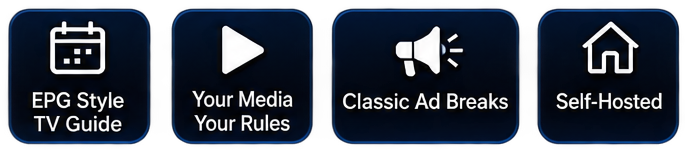
</p>

## Setup guide

<p align="center">
  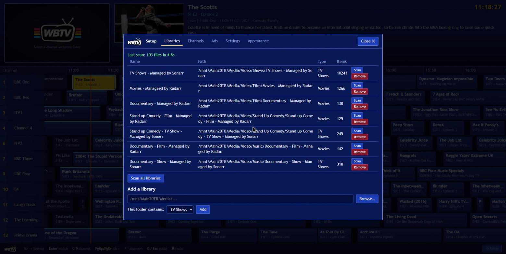
  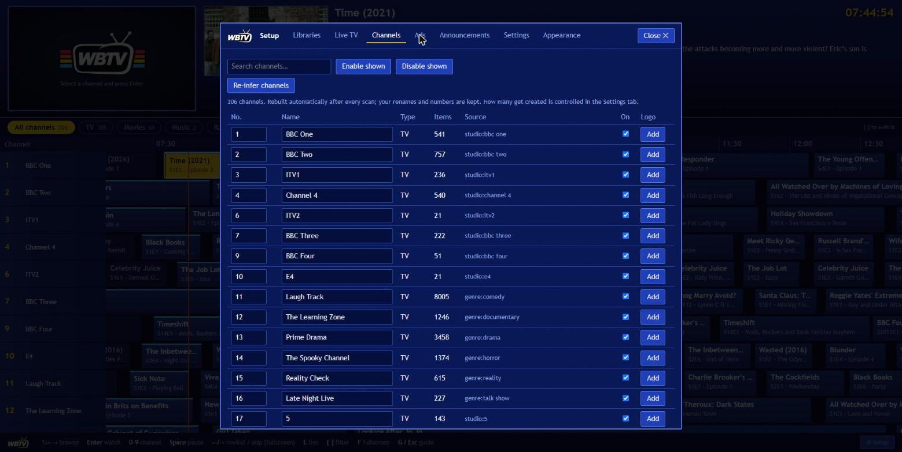
</p>
<p align="center">
  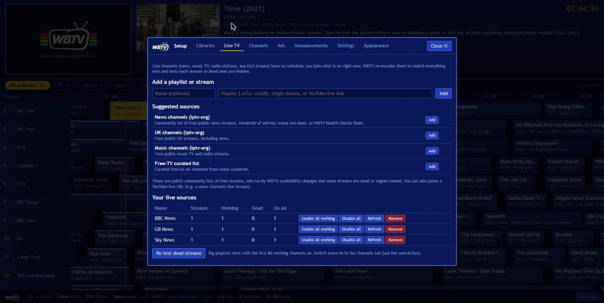
  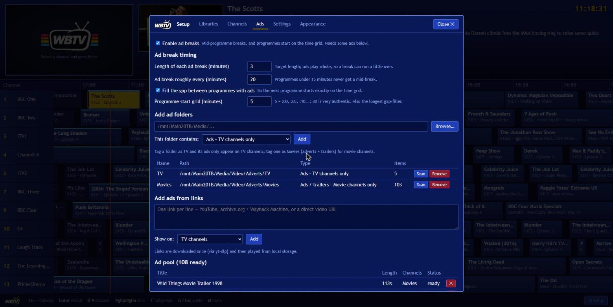
</p>
<p align="center">
  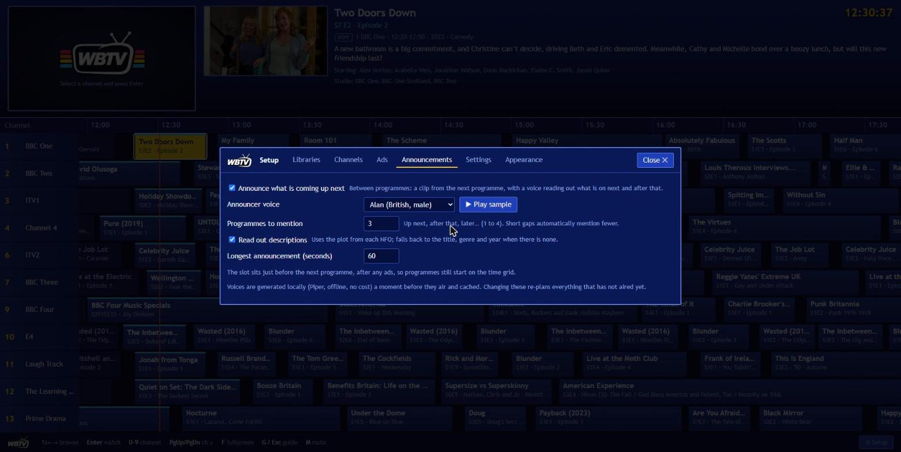
  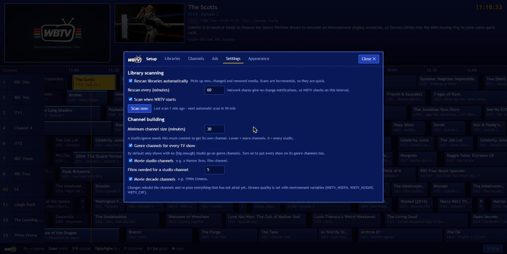
</p>
<p align="center">
  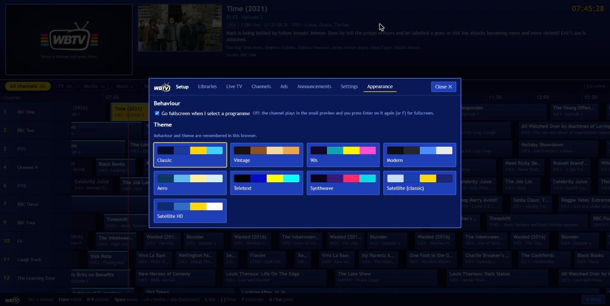
</p>

1. **Libraries**: add a folder and say what's in it: *TV Shows*, *Movies*, *Music videos*, *Radio* (and the spoken-word types) feed channels; *Ads* folders feed ad breaks.
2. **Live TV**: add an IPTV playlist, a stream or a YouTube live link.
3. **Channels**: check what was built (there is a search box), rename or renumber things, switch channels on and off, upload a logo.
4. **Ads** (optional): turn on ad breaks, set how long and how often, add ad folders or links.
5. **Announcements**: switch the voice-overs on or off, pick the voice (with a sample button) or install more, and choose how many programmes to mention.
6. **Settings**: automatic rescans, the pause/rewind buffer, how many channels get created, presentation (logos, idents, closedown, dayparting, lyrics), video encoding, and security.
7. **Appearance**: pick a theme, and whether selecting a programme jumps straight to fullscreen.

### Music, radio and live channels

| Add this | Library type | What you get |
|---|---|---|
| Music video folder | **Music videos** | Channels by genre/decade, numbered from 400, lower-third per track |
| Audio folder (mp3/flac/m4a...) | **Radio** | Stations by genre/decade, numbered from 800, cover art, lyrics and a live waveform |
| Interview recordings | **Radio: interviews** | One station named after the library, shuffled |
| Podcast folders (one folder per show) | **Radio: podcasts** | **One channel per show**, episodes oldest first, looping (or switch the library to one station that rotates between shows) |
| Audiobooks (`.m4b`, or a folder of chapter files per book) | **Radio: audiobooks** | One station: one book at a time, chapters in order, then the next book. Tick *one channel per show / book* in Setup > Libraries for a channel per book that always plays in order and loops |
| `.m3u` / `.m3u8` playlist, single stream, or YouTube live URL | **Live TV** tab | One channel per stream, numbered from 600; dead streams hidden |

**Lyrics:** put a `.lrc` (time-synced), `.srt` or `.txt` file next to a track with the same name (`01 - Song.flac` + `01 - Song.lrc`), or keep them in the file tags, and they appear under the cover art. Synced lyrics follow the song; plain text is paged across it as an estimate. Switch it off in Setup > Settings.

<p align="center">
  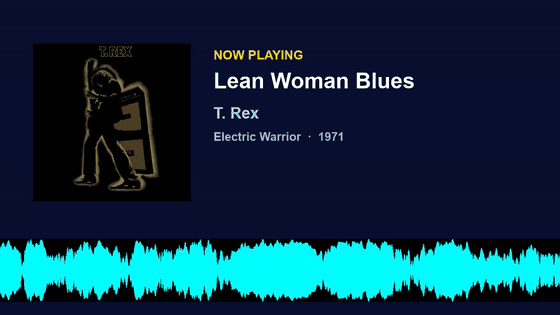<br>
  <sub>A radio channel: cover art, now playing, time-synced lyrics (from a <code>.lrc</code> file) and a live waveform.</sub>
</p>

**Cover art** comes from a `cover.jpg` / `folder.jpg` in the album folder or from the picture embedded in the files (read once per album). Spoken-word stations read the tags in your files (title, show or book, author, date, track number, description) and fall back to folder names. Like a real broadcast, you join mid-episode.

Big playlists (more than 80 streams) start with the first 80 *working* channels switched on; use the **Channels** tab search box and *Enable shown* to switch on more, or *Enable all working* on the Live TV tab. The built-in suggestions point at public community lists of free streams (not run by WBTV), so availability changes and some are region-locked. YouTube live links are resolved with yt-dlp each time you tune in.

<p align="center">
  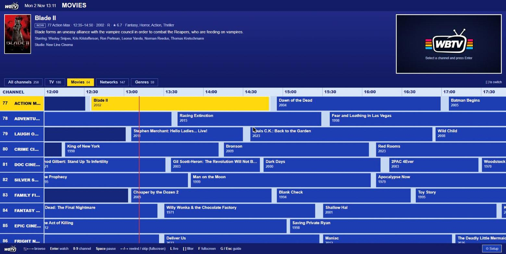
</p>

**Web keys:** arrows to browse, Enter to watch, 0-9 for a channel number, Space to pause, Left/Right to rewind or skip in fullscreen, L to go back to live, F for fullscreen, G or Esc for the guide, `[` and `]` for the filter chips.

### Find and download music videos (optional)

Setup > **Music videos** can look up each artist in your music library on [IMVDb](https://imvdb.com/developers/api) (bring your own free app key), show which of their videos you already have, and download the rest into your Music Video folder with the right name, year and genre. It needs a WBTV password and that one folder mounted **writable** (drop the `:ro` on just that volume). See [docs/FEATURES.md](docs/FEATURES.md#music-video-discovery-and-download-imvdb-optional).

### Tidy your music videos (optional)

Music videos from YouTube usually carry an upload date as their "year" and a messy file name, which gives you one or two dull channels. WBTV ships a small tool that renames them to `Artist - Title`, writes proper `.nfo` files with the real release year and genre (taken from your own music library), and sets duplicate copies aside. It is a dry run until you say `--apply`, and everything can be undone. See [tools/README.md](tools/README.md).

## Folders or a media server?

WBTV can read your library two ways, and you can mix them. **Folders are the default and the best-tested route.** Reading from a media server is an option for when folders aren't practical. Neither is "better" in general, so here is an honest comparison to help you choose.

| | **Folders (direct)** | **Media server (Jellyfin / Emby for TV and films, Navidrome for music)** |
|---|---|---|
| **How it plays** | ffmpeg reads each file straight from disk | ffmpeg reads the original over HTTP from the server (no transcoding on the server's side) |
| **Start-up speed** | Fastest: seeking is local | A little slower, because every piece goes through the server. Not measured on every setup, so test with your own |
| **Network use** | None | Every watched channel pulls its full bitrate across your network (fine on gigabit) |
| **Scanning** | Reads files and `.nfo` tags, probes durations. Slower the first time, incremental after | Usually faster: one API call per 500 items, because the server already indexed everything. Pictures download a few hundred per scan |
| **Metadata** | As good as your `.nfo` tags and folder names | The server's metadata, often richer. Studios and genres can differ from your `.nfo` tags, so **channel names and numbers can change** |
| **Subtitles and lyrics beside the file** (`Movie.en.srt`, `Song.lrc`) | Found automatically | Not visible to WBTV. Embedded subtitles work but are extracted by reading the whole file over HTTP. Navidrome supplies its own lyrics instead |
| **If the server is down** | Unaffected | Its channels can't play until it's back, and a revoked key stops them |
| **Needs the files mounted into WBTV** | Yes | No, so WBTV can run on a different machine from your media |
| **Moving parts** | One | Two (WBTV plus the server), and a key or login to keep valid |
| **Switching later** | | Items get new IDs, so the schedule re-plans. Replace a library rather than adding the same content twice, or it will appear twice |

**Choose folders if** your media is already mounted where WBTV runs, your `.nfo` tags give you good channels, or you want the fewest moving parts.
**Choose a media server if** WBTV runs somewhere that can't see your files, your tags are sparse and you'd rather use the server's metadata, or you'd like one place to manage everything.

**Navidrome (music).** Add it under *Setup > Libraries > Or read libraries from a media server*: enter the address and your Navidrome login. WBTV keeps a token, not your password. Each album's cover art and the songs' lyrics (time-synced where the server has them) come from Navidrome, which avoids guessing from file tags. Audiobookshelf (audiobooks and podcasts) and Plex are not supported yet.

## Use WBTV in Plex, Jellyfin, TiviMate and other players

WBTV can act as a TV tuner, so every channel (with its ads and announcements) shows up in the apps you already use.

| You want to use | Add this |
|---|---|
| **Plex / Jellyfin / Emby Live TV** | Add an *HDHomeRun* tuner at `http://<server>:8420`, then use the XMLTV guide below |
| **TiviMate, VLC, Kodi, Channels, any IPTV app** | Playlist: `http://<server>:8420/iptv/playlist.m3u` |
| **Guide data (XMLTV)** | `http://<server>:8420/iptv/epg.xml` (as far ahead as the schedule is planned, about 14 hours) |

The HDHomeRun emulation serves a normal MPEG-TS stream without re-encoding, so it costs almost no extra CPU on top of the shared channel stream.

## Android TV app

<p align="center">
  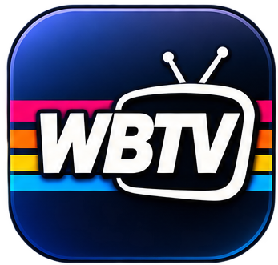
</p>

A native Kotlin / Jetpack Compose / Media3 app. It opens on your last channel, like switching a TV on, and is built for the remote. Download the APK from the
[latest release](https://github.com/WB2024/WBTV/releases/latest) and install it (`adb install -r`, or use a "Downloader"-style app on Fire TV). On first launch it asks for your server address,
e.g. `192.168.1.110:8420`. Needs Android 8 or newer; tested on a Fire TV (Android 9).

<p align="center">
  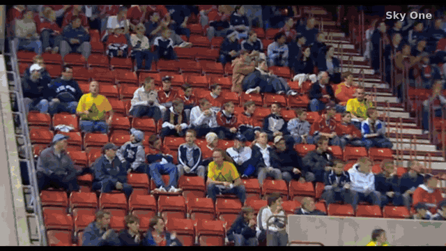<br>
  <sub>Recorded on a Fire TV in the Sky-style Satellite theme: Right opens the guide, then flick through channels with the d-pad. The poster, plot and what's on update as you go.</sub>
</p>

<p align="center">
  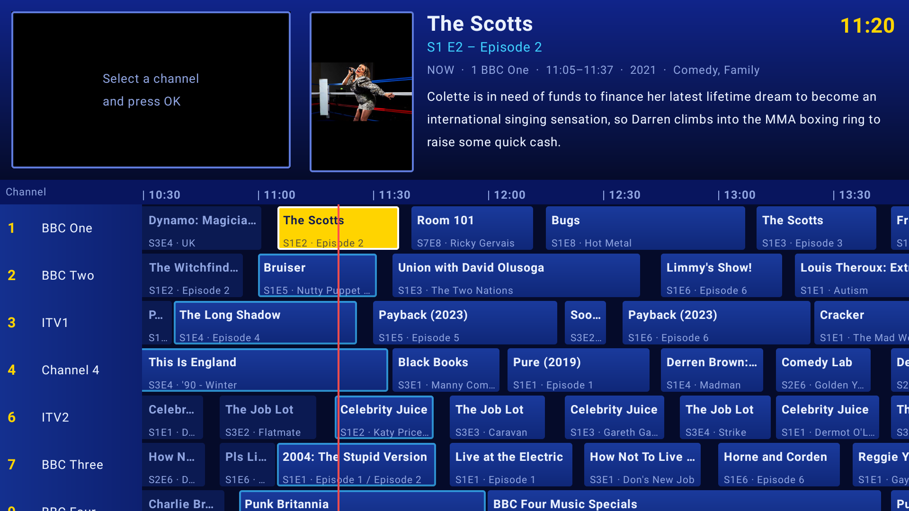
  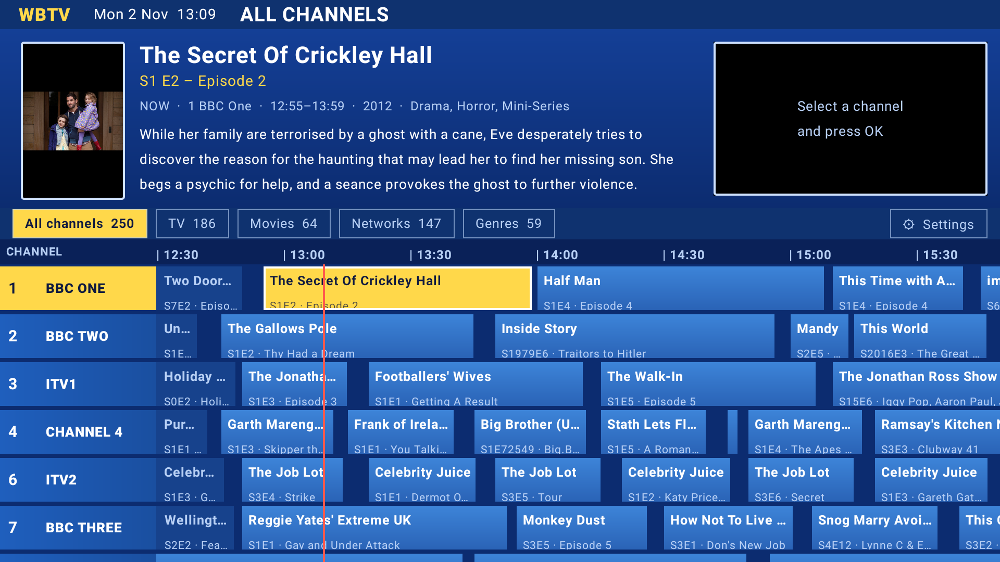
</p>
<p align="center">
  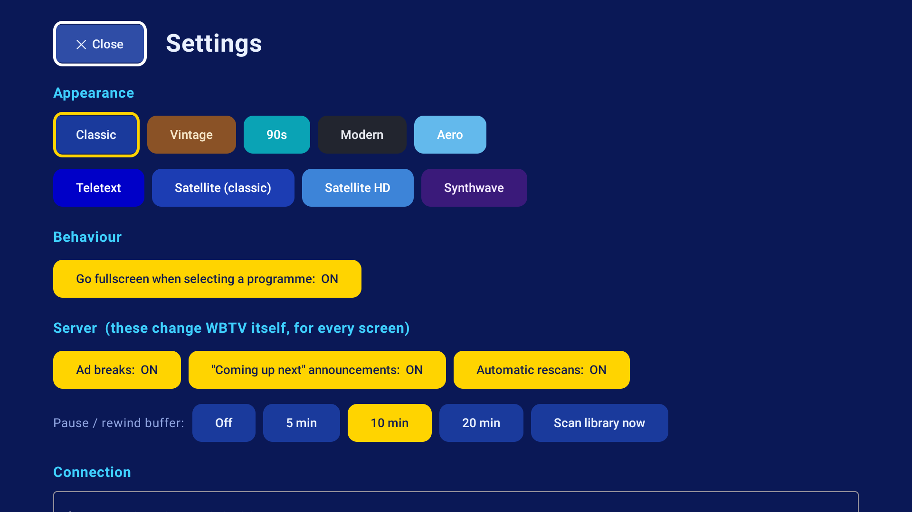
  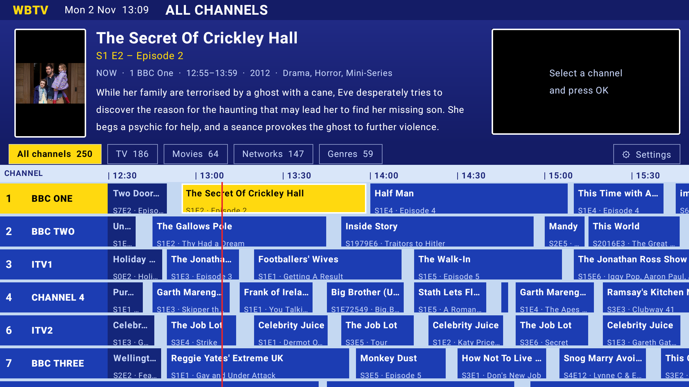
</p>

| Key | Watching | In the guide |
|---|---|---|
| Up / Down, CH+ / CH- | next / previous channel | move between channels; Up from the top row goes to the filter chips and **Settings**. **Rewind / Fast-forward** step through the filter chips from anywhere |
| Left | last channel | previous programme |
| Right / OK / Guide | open the guide | next programme / tune it |
| Info | info banner (progress, minutes left) | |
| Play / Pause | pause or resume live TV | same |
| Rewind / Fast-forward | back 30 s / forward 30 s (past the live edge = back to live) | |
| 0-9 | jump to channel number | same |
| Menu | settings | settings |
| Back | press twice to exit | close the guide |

**Settings** (Menu, or Up from the top row of the guide then the Settings button): theme, fullscreen behaviour, an access key, and the server's own switches (ad breaks, announcements, logos, idents, closedown, dayparting, era-matched ads, stream size, rescans), so you can change them without a laptop.

<details>
<summary>Build it yourself</summary>

Needs JDK 17+ and the Android SDK (e.g. from Android Studio):

```bash
cd android
./gradlew assembleDebug        # -> app/build/outputs/apk/debug/app-debug.apk
adb connect <tv-ip>:5555
adb install -r app/build/outputs/apk/debug/app-debug.apk
```
</details>

## Samsung TV app

A small TV-only client for Samsung (Tizen) TVs, made for the remote: the guide with a chip for every channel group, a picture and description that follow the track playing, and live playback through Samsung's AVPlay. Plain JavaScript, no build step. Tested on a 2022 Samsung The Frame (Tizen 6.5).

Samsung TVs only run signed apps. Download `WBTV-Tizen.wgt` from the [Tizen release](https://github.com/WB2024/WBTV/releases/tag/tizen-v0.1.0) and install it with [Apps2Samsung](https://github.com/Apps2Samsung/Apps2Samsung) (**Custom WGT File**, with the TV in Developer mode), or build and sign it yourself with Tizen Studio's command line. The remote keys, the TizenBrew route and a desktop-browser preview are in [tizen/README.md](tizen/README.md).

## Themes

<p align="center">
  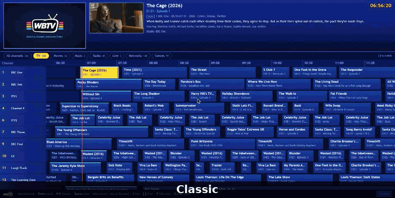<br>
  <sub>Nine themes, switchable any time, on the web and on Android TV.</sub>
</p>

<details>
<summary>See them all at once</summary>

<p align="center">
  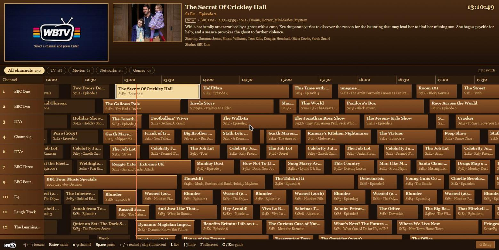
  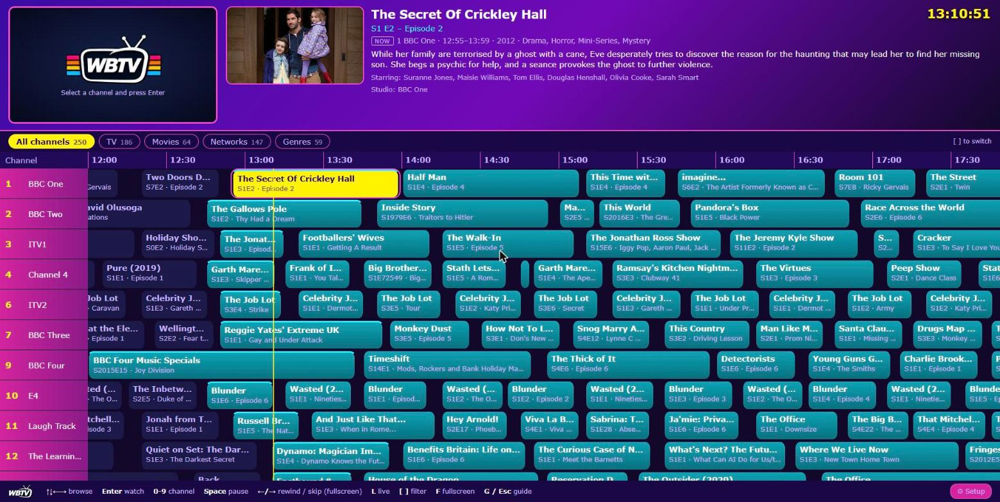
</p>
<p align="center">
  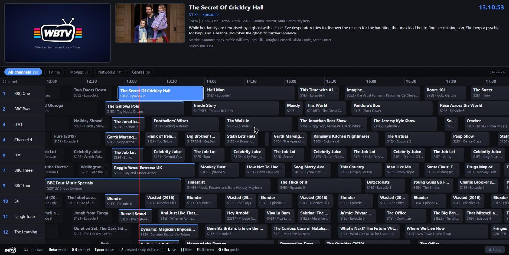
  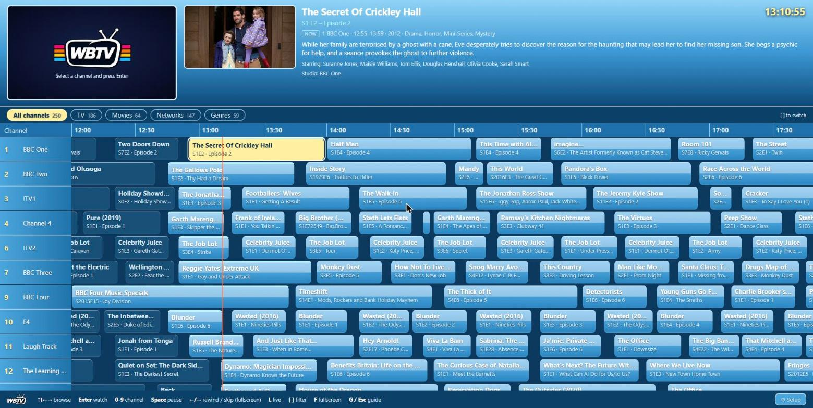
</p>
<p align="center">
  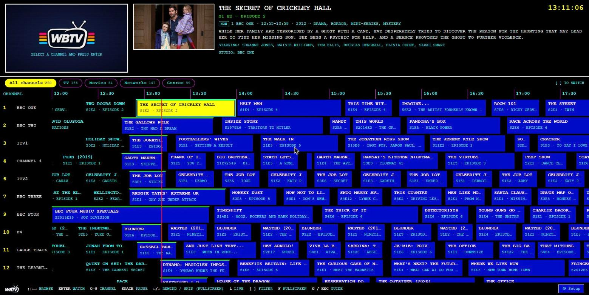
  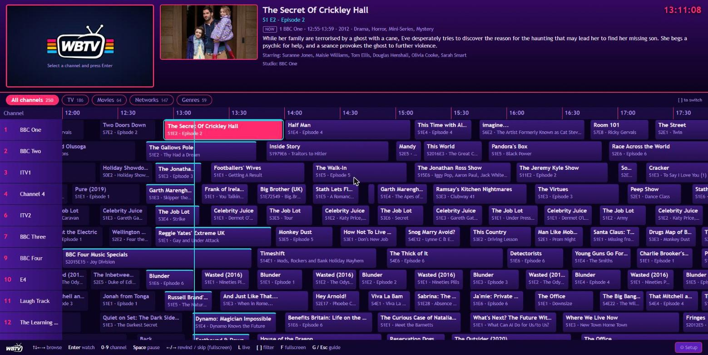
</p>
<p align="center">
  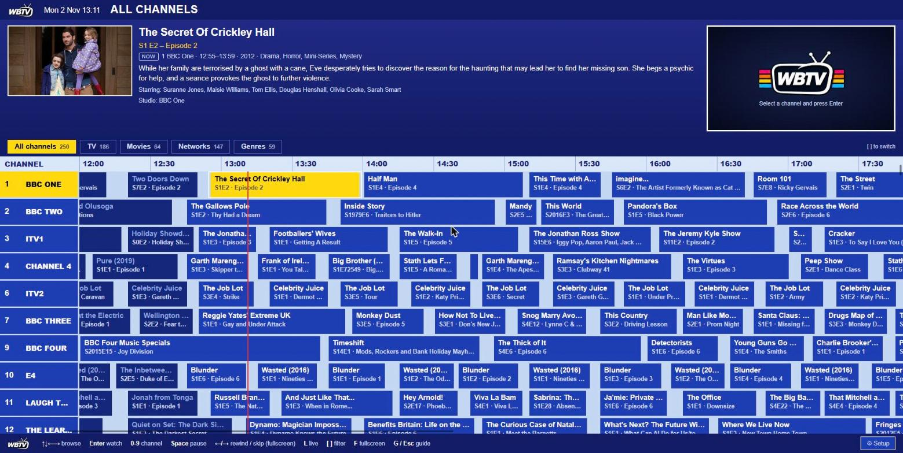
  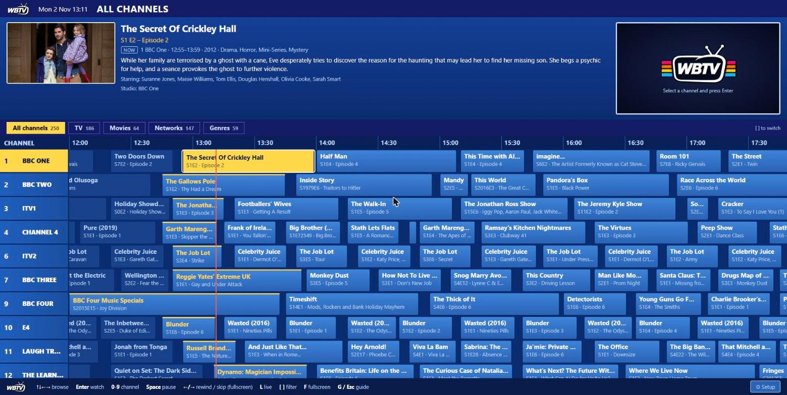
</p>

</details>

## Performance

Every channel you watch is encoded live (ffmpeg, H.264), and everyone watching the same channel shares one encode. A channel stops about 25 seconds after its last viewer leaves.
Rough guide: **one CPU core per channel being watched at 720p**. If the machine also runs other apps, in **Setup > Settings > Video encoding**:

- **Stream size:** 576p uses roughly 30% less CPU per channel than 720p; 480p is the lightest.
- **Hardware encoding:** see below, if the server has a GPU.
- **Announcement voices:** the high-quality voices sound best but need about three times the CPU to generate. The default voices are light.

Open `http://<server>:8420/api/status` to see what the server is doing right now (channels running, viewers, CPU load, memory, queued voice-overs).
WBTV logs a line such as `tune-in 7.4s (slow): ...` whenever a channel takes more than 6 seconds to start, with a breakdown (`docker logs wbtv`); set `WBTV_DEBUG=1` to log every start.

### Hardware encoding (optional)

Settings > Video encoding is **Automatic** by default: WBTV runs a real test encode and silently falls back to the CPU if the GPU is not usable, and the Settings page tells you which one is in use.

- **Intel / AMD (VAAPI):** add `devices: ["/dev/dri:/dev/dri"]` to the compose service (on Proxmox LXC, pass `/dev/dri/renderD128` through to the container first).
- **NVIDIA (NVENC):** install the NVIDIA container toolkit and add `runtime: nvidia` with `NVIDIA_VISIBLE_DEVICES=all` and `NVIDIA_DRIVER_CAPABILITIES=video,compute,utility`.

Scaling and on-screen captions still run on the CPU; only the H.264 encode moves. *(New in 0.8 and so far tested only through its self-test and fallback path. If you have a GPU, [please tell me how it goes](https://github.com/WB2024/WBTV/issues/1).)*

## Configuration

| Environment variable | Default | |
|---|---|---|
| `TZ` | `UTC` | Your timezone, so the guide and day-parting match your clock |
| `WBTV_WIDTH` / `WBTV_HEIGHT` | `1280` / `720` | Stream resolution (also in Settings > Stream size) |
| `WBTV_CRF` | `23` | x264 quality (lower = better and bigger) |
| `WBTV_PRESET` | `veryfast` | x264 speed preset |
| `WBTV_BROWSE_ROOTS` | `/mnt,/media,/data` | Folders the in-app folder browser may show |
| `WBTV_DEBUG` | off | Log every channel start-up with timings |
| `PIPER_BIN` / `PIPER_VOICES` | `/opt/piper/piper` / `/opt/piper/voices` | Speech engine and voice folder (already in the image). Extra voices install to `/config/voices` |

### Security

By default WBTV has **no login**: it is built for a home network. If you open it up (or just want a lock on it), turn on a password in **Setup > Settings > Security**.
Browsers log in once; the Android TV app, IPTV players and Plex/Jellyfin use an **access key** shown on the same page. Don't expose any self-hosted app to the internet over plain http;
put it behind HTTPS with a reverse proxy such as Caddy or Nginx Proxy Manager. Your media is mounted read-only, and WBTV never writes to it. The full API is documented in [docs/API.md](docs/API.md).

## Status

WBTV is young, maintained by one person, and developed on real hardware (a Proxmox LXC and a Fire TV). Here is exactly where it stands:

| Area | State |
|---|---|
| Web UI, scheduling, ads, announcements, music/radio/lyrics, live IPTV/YouTube, M3U/XMLTV/HDHomeRun | ✅ In daily use |
| Android TV / Fire TV app | ✅ Tested on a Fire TV (Android 9); ran for a full night without a crash |
| Samsung (Tizen) TV app | 🟡 New. Guide, chips and live playback work on one 2022 The Frame (Tizen 6.5); no other model tried |
| CPU (x264) encoding, amd64 | ✅ The tested path |
| Hardware encoding (VAAPI / NVENC) | 🟡 New. Self-test and fallback verified; not yet seen on a real GPU |
| arm64 (Raspberry Pi 4/5) | 🟡 Built by CI; not yet run on real hardware |
| Jellyfin / Emby as a *source* | ✅ Read TV and films through the server's API (Setup > Libraries), no shared folders needed. See [Folders or a media server?](#folders-or-a-media-server) |
| Navidrome as a *source* | ✅ Music for radio stations, with the server's cover art and lyrics. Tested against a mock server; not yet against a real Navidrome in daily use |
| Plex as a *source* | ❌ Not yet (Plex works as a *tuner* target today) |
| Hand-built schedules / drag-and-drop channel editor | ❌ By design for now: channels are inferred. Overrides for names, numbers and on/off exist |
| Subtitles and audio-track choice | ✅ Preferred-language audio, and subtitles burned into the picture when needed (text subtitles, from a file beside the video or inside it). Bitmap subtitles (PGS/DVD) are not supported yet |

If something misbehaves, please [open an issue](https://github.com/WB2024/WBTV/issues/new/choose) and include the output of `http://<server>:8420/api/status` and `docker logs wbtv`.

## FAQ

**Does it change or move my files?** No. Media is mounted read-only. WBTV stores its own database, covers and downloaded ads in `/config`.

**Do I need Plex or Jellyfin?** No. WBTV reads folders directly. It can also read a Jellyfin or Emby library through the server's API, and *feed* Plex, Jellyfin and Emby as a Live TV tuner.

**Do I have to tag everything with `.nfo` files?** No, but tags make the channels much better. Kodi/Jellyfin/Sonarr/Radarr-style `.nfo` files are read (studio, genre, plot, cast, rating). Without them WBTV falls back to folder and file names.

**Does it need a GPU?** No. It runs on the CPU. A GPU lets you run more channels at once.

**Can several people watch at once?** Yes. Viewers on the same channel share one encode; each extra channel being watched costs about one core.

**Is it really free? What's the catch?** There is none. It's MIT licensed and will stay free. If you like it, you can [buy me a coffee](https://buymeacoffee.com/succinctrecords).

**Where do the ads come from?** From you: YouTube / archive.org / direct links (downloaded once with yt-dlp) or local folders. WBTV ships with none.

**Does the voice use an AI service?** No. Announcements are generated offline on your own machine with [Piper](https://github.com/rhasspy/piper). Nothing leaves your network.

## Troubleshooting

| Problem | Try |
|---|---|
| The guide is empty | Add a library in **Setup > Libraries** and wait for the first scan; check the folder is mounted under `/media` (or set `WBTV_BROWSE_ROOTS`) |
| Channels are slow to start | See [Performance](#performance): lower the stream size, use hardware encoding, and check `/api/status` for what else is running |
| Cover art is missing on some radio tracks | Art is read from `cover.jpg`/`folder.jpg` or from the file itself, and older libraries fill in gradually over the next scans |
| A live/YouTube channel shows as dead | Streams are health-checked and resolved with yt-dlp; check the source plays elsewhere, and that the container can reach the internet |
| Times in the guide are wrong | Set `TZ` on the container |

## Project layout

```
src/         Node.js server: scanner, channel inference, scheduler, live HLS broadcaster, API
public/      Web UI (vanilla JS)
android/     Android TV app (Kotlin, Compose, Media3); unit tests: ./gradlew testDebugUnitTest
tizen/       Samsung (Tizen) TV app (plain JavaScript, no build step)
tools/       Command-line helpers, including mvdl.py, the music video downloader
docs/        API reference, full feature list, comparison with other tools
test/        Unit tests (npm test)
Dockerfile   Node 24 + ffmpeg + yt-dlp + Piper (speech); multi-arch (amd64, arm64)
```

Contributions are welcome. See [CONTRIBUTING.md](CONTRIBUTING.md).

## ☕ Support WBTV

WBTV is **free, open source and will stay that way**. It is built and tested in spare time on real hardware. If you enjoy it, please consider supporting development. Every coffee goes straight into new features and keeping things working.

<p align="center">
  <a href="https://buymeacoffee.com/succinctrecords"></a>
</p>

Not able to donate? A star on the repo and telling a friend helps just as much. ⭐

## Credits

The demo clips in this README use *Big Buck Bunny* (&copy; 2008 Blender Foundation, [bigbuckbunny.org](https://peach.blender.org), licensed [CC BY 3.0](https://creativecommons.org/licenses/by/3.0/)). The Android TV and guide recordings were made on a real library.

## Licence

[MIT](LICENSE). Piper (speech) and ffmpeg and yt-dlp are separate projects with their own licences; the container image bundles them.

<p align="center">
  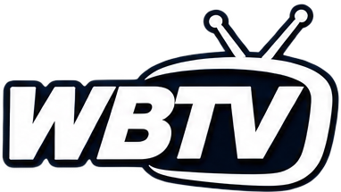
</p>
